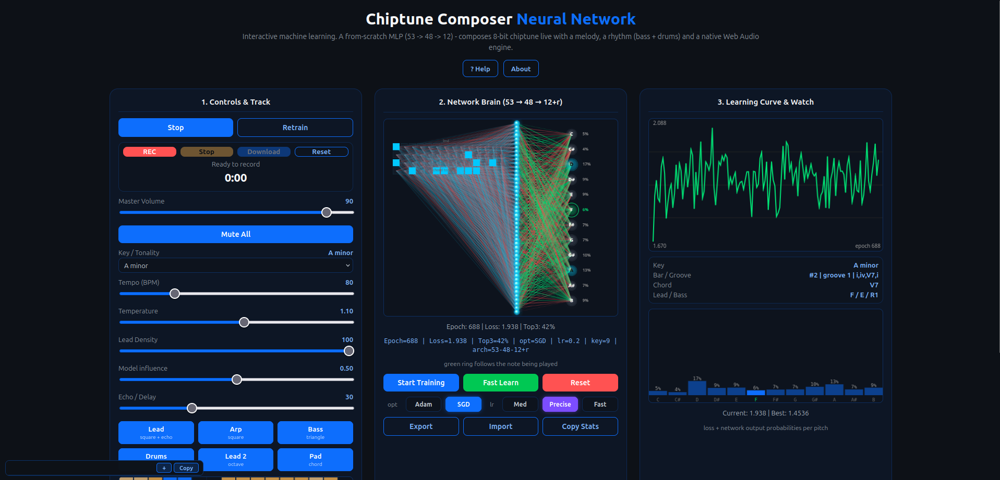

# chiptune-composer-neural-network

[](https://github.com/smartlegionlab/chiptune-composer-neural-network/releases)

[](https://github.com/smartlegionlab/chiptune-composer-neural-network/blob/master/LICENSE)
[](https://github.com/smartlegionlab/chiptune-composer-neural-network/stargazers)
[](https://github.com/smartlegionlab/chiptune-composer-neural-network/network/members)


An interactive **8-bit chiptune composer** driven by a from-scratch MLP plus a trainable harmony net, written **in pure JavaScript**. No frameworks, no libraries, no audio samples. Every note is synthesized live in the browser with the Web Audio API. Current version: **1.0.2**.

---

## Demo

Listen to a pre-composed chiptune sample: **[data/audio/example.mp3](data/audio/example.mp3)**.

Try the live composer: **[Chiptune Composer Neural Network](https://smartlegionlab.github.io/interactive/chiptune-composer-neural-network.html)** (or serve the repo locally, see Getting started below).



---

## Overview

This standalone application implements the full training pipeline by hand - forward pass, error backpropagation, weight updates with gradient descent - and then composes a **structured song**: intro, verses, choruses, a calm bridge and a big finale. The main MLP (53 -> 48 -> 12) predicts the next pitch class and the groove for bass + drums. A second dedicated harmony net learns chord transitions from classic minor progressions: Am-F-C-G, Am-Dm-Em-Am, Am-G-F-E (Andalusian), Am-C-G-F and more.

Each new track starts with a randomly chosen key, tempo and arrangement, and every 4-bar phrase resolves through the dominant (V7 - i) so the song always lands on proper cadences.

Every track the composer plays is auto-saved to a **Track Playlist** (max 3, the 4th replaces the 1st): you can play/pause it, stop it, download it as .wav or delete it. Your own REC recordings stay separate.

---

## Features

- Networks trained from scratch in plain JavaScript (sigmoid activation, backpropagation, mini-batch SGD with momentum).
- Two networks: melody/groove MLP (53 -> 48 -> 12 + 4) and a harmony classifier (53 -> 16 -> 7 chord functions).
- Song orchestrator: intro, verse, chorus, verse, bridge, final chorus, outro.
- Cadence grammar: every 4th bar resolves (V7 - i), the final bar lands on the tonic.
- 12 minor keys with strictly diatonic chords (Am, Dm, Em, F#m, Bm and more).
- Song composer that always stays in key and follows the chord progression.
- Note Pad: play a melody with the mouse, save it as a training example, and teach the network your style.
- Native Web Audio engine: square and triangle voices plus noise drums, echo/delay feedback, low-pass, per-channel mutes, master volume.
- Live visualization: pulsing neuron orbs, synapse lines, pitch-probability bars with scale degrees (1-7, x = off scale).
- Record to .wav: capture a 16-bit PCM recording and download it.
- Track Playlist: every composed track is auto-saved (max 3, oldest dropped); Play / Pause / Resume, Stop, Download or Delete. The composer and the playlist mute each other automatically.
- Volume is fully under your control: only the **Master Volume** slider and **Mute All** change loudness, there is no automatic fade.
- Model persistence: export/import the trained composer (including your examples) as JSON.
- Responsive layout: 3-column panels on desktop/landscape, single column in portrait.
- Built-in Help and About dialogs.

---

## Getting started

### Run with a local server

The application is split into an HTML file, a stylesheet and a script, so **opening the HTML file directly by double-click will not work** - serve the folder over HTTP:

```bash
python -m http.server 8000
```

then open [http://localhost:8000](http://localhost:8000). Any static server works (for example `npx serve` or a GitHub Pages deployment). No build step, no package manager, and no internet connection is required.

### How to use

1. Press **Play** - it unlocks Audio, the network decides a key and tempo, and composes a full structured song. Volume is controlled only by the **Master Volume** slider.
2. **New Song** rolls another arrangement. **Loop** keeps generating new tracks forever.
3. Track Playlist: each track the composer plays is auto-saved here (max 3). **Play / Pause / Resume** to listen, **Stop** to end, **Download** to save as .wav, **Delete** to remove. The composer and the playlist mute each other automatically.
4. Note Pad: press **Rec**, click notes to play a beautiful melody, **Save Ex** adds it to the training set, **Learn Ex** teaches the network your style.
5. Record your track: **REC** - **Stop** - **Download** (.wav); **Reset** clears. REC recordings stay separate from the Track Playlist.
6. Adjust **Master Volume**, **Mute All / Unmute All** and each channel's own Mute (echo is shared by Lead, Arp and Lead2).
7. Choose **Key**, **Tempo**, **Temperature**, **Lead Density**, **Model influence**, **Echo**.
8. **Copy Stats** / **Export / Import** saves and loads the trained composer as JSON.

---

## Architecture

- Melody/groove MLP: 53 inputs -> 48 sigmoid hidden neurons -> 12 pitch-class outputs + 4 groove outputs.
- Harmony MLP: 53 inputs -> 16 sigmoid hidden neurons -> 7 chord-function outputs, trained with label smoothing.
- Loss: cross-entropy with softmax for all heads, mini-batch SGD (momentum 0.9), weight decay, gradient and weight clipping.
- Features: last and previous note, chord root, chord tones, phrase position, scale mode and section context, all relative to the key so the model transposes.
- Melody: generated from the network distribution blended with the chord/scale theory model and temperature-sampled, always staying in key.

An educational demo of live music generation - every note is synthesized in the browser and the piece stays in key, follows a chord progression and resolves with proper cadences.

---

## Ecosystem

This project is part of the **Smart Legion Lab** from-scratch neural-network ecosystem - a collection of eight independent demos in pure JavaScript, each with live visualization, model export/import, a responsive 3-column layout and built-in Help/About dialogs. Every app lives in its own standalone repository; the collection page is [from-scratch-neural-networks](https://github.com/smartlegionlab/from-scratch-neural-networks) with the full index at [interactive.html](https://smartlegionlab.github.io/interactive.html).

| # | Project                       | Network          | Learns                       | Repository                                                                                                       | Live demo                                                                                         |
|---|-------------------------------|------------------|------------------------------|------------------------------------------------------------------------------------------------------------------|---------------------------------------------------------------------------------------------------|
| 1 | Boolean-Logic Neural Network  | 2 → 3 → 1        | XOR / AND / OR / NAND / XNOR | [logic-gates-neural-network](https://github.com/smartlegionlab/logic-gates-neural-network)                       | [try it](https://smartlegionlab.github.io/interactive/logic-gates-neural-network.html)            |
| 2 | Handwritten-Digit Recognition | 144 → 24 → 10    | Handwritten digits 0-9       | [digit-recognition-neural-network](https://github.com/smartlegionlab/digit-recognition-neural-network)           | [try it](https://smartlegionlab.github.io/interactive/digit-recognition-neural-network.html)      |
| 3 | X / O Shape Recognition       | 64 → 12 → 2      | The letters X and O          | [x-o-recognition-neural-network](https://github.com/smartlegionlab/x-o-recognition-neural-network)               | [try it](https://smartlegionlab.github.io/interactive/x-o-recognition-neural-network.html)        |
| 4 | Name Gender Classifier        | 2,746 → 48 → 1   | Gender from RU/EN names      | [name-gender-classifier-neural-network](https://github.com/smartlegionlab/name-gender-classifier-neural-network) | [try it](https://smartlegionlab.github.io/interactive/name-gender-classifier-neural-network.html) |
| 5 | Chiptune Composer             | 53 → 48 → 12+r   | Compose 8-bit chiptune live  | [chiptune-composer-neural-network](https://github.com/smartlegionlab/chiptune-composer-neural-network)           | [try it](https://smartlegionlab.github.io/interactive/chiptune-composer-neural-network.html)      |
| 6 | RGB Color Name Guesser        | 3 → 24 → 12      | Names any RGB color          | [rgb-color-name-guesser-neural-network](https://github.com/smartlegionlab/rgb-color-name-guesser-neural-network) | [try it](https://smartlegionlab.github.io/interactive/rgb-color-name-guesser-neural-network.html) |
| 7 | Morse Decoder                 | 10 → 16 → 36     | Morse code A-Z and 0-9       | [morse-decoder-neural-network](https://github.com/smartlegionlab/morse-decoder-neural-network)                   | [try it](https://smartlegionlab.github.io/interactive/morse-decoder-neural-network.html)          |
| 8 | Tic-Tac-Toe Brain             | 27 → 48 → 32 → 9 | Perfect Tic-Tac-Toe play     | [tic-tac-toe-brain-neural-network](https://github.com/smartlegionlab/tic-tac-toe-brain-neural-network)           | [try it](https://smartlegionlab.github.io/interactive/tic-tac-toe-brain-neural-network.html)      |

Each app is served the same way: run a local server (`python -m http.server 8000`) or open the GitHub Pages demo link above; no build step and no internet connection required.

---

## License

This project is licensed under the **BSD 3-Clause License** - see [LICENSE](LICENSE).

---

**Author:** Alexander Suvorov · **Repository:** [github.com/smartlegionlab/chiptune-composer-neural-network](https://github.com/smartlegionlab/chiptune-composer-neural-network)

